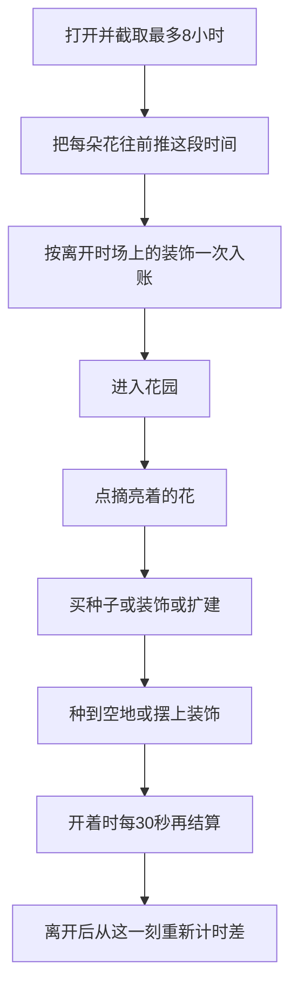

# 方块花园 · 种花挂机玩法流程

> 状态：设计定稿（2026-10-10）
>
> 本文只定玩法。不改渲染、存档格式、分享实现，也不改代码。
>
> 叠在现有离线编辑器上：场地固定为 `src/core/world.ts` 的 10×10×10，地面在 y=0，装饰是道具层。截图发笔记仍是终点。旧花方块不当作物。

## 1. 已定规则

- 花是作物。点成熟的花才拿金币，这一格清空，可以再种。成熟前铲掉，种子回到背包。成熟后一直留着，直到亲手摘，不自动再结，也不弹窗代摘。
- 种子要花钱。短花便宜、3 分钟熟；长花贵、4 小时熟、单次净赚更高。开局送 5 颗短花种子，金币为 0。
- 只扩地面：中心 5×5 可种可摆，再开 7×7，最后 10×10。锁着的地看得见，不能种、不能摆、不能改。高度从一开始就是 10，用来垫草、土、石、叶。这四类不花钱。
- 装饰买进背包再摆，拆掉回背包，不退金币。一般不往上叠，一件占自己的地面占地。挂机只数已经摆在场上的件数，背包里的不算；大件占多格仍只算一件。
- 现有引擎里带 `supportsItems` 的桌子可以在顶上再放东西。这一轮商店装饰都不带这个能力。桌上再放的那件也不计挂机。
- 比较口径：同一格按时「种、等、摘、再种」时，每分钟净赚高于这一格那一件装饰的每分钟挂机。

## 2. 挂机结算

在线和离线用同一套速率，入账方式不同。

- 在线：小工具开着时，每 30 秒结算一次。结算额 = 当前场上速率 × 30 秒。打开着一直按这个间隔跳，没有 8 小时上限。
- 离线：从离开到再打开的时差，超过 8 小时只取 8 小时。回来时按「速率 × 这段有效时长」一次入账，然后改回每 30 秒结算。这段离线窗口不重复计进之后的 30 秒。
- 时钟往回拨，这段记 0。往前跳，按离线时差处理，同样最多 8 小时。
- 内部可以有零头。界面金币只显示整数，凑满 1 再入账，零头留到下一次。

速率比例是普通 : 中等 : 高级 = 1 : 2 : 3。30 秒是入账间隔，单次入账可以小于 1 金币。

- 普通（盆栽、蘑菇）：每 30 秒 0.025，约 20 分钟满 1 金币，每小时 3。离线封顶 24。售价 30，约 10 小时回本。
- 中等（树篱、木箱）：每 30 秒 0.05，每小时 6。离线封顶 48。售价 80，约 13 小时回本。
- 高级（树、松树）：每 30 秒 0.075，每小时 9。离线封顶 72。售价 160，约 18 小时回本。

25 件高级摆满一晚是 1800，够付第一次扩建（800），不够付第二次（3200）。

花的生长用同一段离线窗口，最长也是 8 小时。在线时花按真实时间长，界面可跟这 30 秒一起刷新。摘花仍是玩家点一下，不会到点自动入账。

拆掉一件装饰，从下一次 30 秒跳动起不再计入。离线入账用的是离开那一刻的件数。

## 3. 一次打开

1. 有效时长 = 离开到现在的时差，超过 8 小时只取 8 小时。
2. 每朵花的计时往前推这段时长。成熟的花留在格子上并发亮。
3. 挂机按离开那一刻场上的装饰件数，用这段时长一次入账。
4. 点成熟的花：金币入账，格子清空。
5. 用金币买种子、买装饰，或点锁区边缘扩建。
6. 种子种在已解锁的空草地或空土上。装饰摆在已解锁、能承托、且没有花的地上。花和装饰不占同一格。
7. 开着的这段时间，每 30 秒按当前场上件数再入账，花也继续长。
8. 可以转视角、截图。离开后，下一次打开再从离开时刻重算时差。

打开时不弹一键收成。截图前花园不会被系统清空。

## 4. 两种花

| | 买价 | 成熟 | 采摘 | 净赚 | 按时每分钟 | 按时每小时 |
|---|---:|---:|---:|---:|---:|---:|
| 短花 | 3 | 3 分钟 | 9 | 6 | 2.00 | 120 |
| 长花 | 20 | 4 小时 | 100 | 80 | 0.33 | 20 |

短花约是高级装饰（每小时 9）的 13 倍，长花约是 2.2 倍。人在花园里时种短花：种下、布置一会儿、亮了就摘。离开前把空地改种长花。

死期和 8 小时封顶接在一起：

- 长花 4 小时成熟。离开 8 小时再回来，它已经亮着，可摘净赚 80。同一格若改摆高级装饰，这 8 小时是 72。花仍然更高。
- 再晚回来，多出来的时间不加挂机，花也不会再结一次。
- 短花离开超过大约 40 分钟还不摘、不重种，这一轮摊下来会低于同格高级装饰。短花用来在场轮种。过夜只结一次，净赚 6；同一格高级装饰的 8 小时是 72。

## 5. 金币怎么花

三个出口：种子、装饰、扩建。

- 种子：短花 3，长花 20。种下去才开始计时。
- 装饰：见第 2 节售价。买进背包再摆，拆掉回背包，不退金币。
- 扩建：5×5 到 7×7 要 800，大约 10 朵按时摘的长花。7×7 到 10×10 要 3200。新地是空草地，原来的花和装饰留在原地。

第一笔 45 金币来自 5 朵赠送短花的采摘，种子免费。长花种子 20 和一件普通装饰 30 加起来是 50，两件一起买不够。这一下要选：先种一朵过夜的长花，或先买一件能进截图的装饰。

金币花光时：场上还有装饰，挂机继续；种子在未成熟时铲掉会回到背包。不会因为买空而再也种不了。

## 6. 和现有编辑器的边界

保留放置、删除、撤销、清空、存档、截图。作物是新的一层，不复用已停用的旧花方块。

撤销只覆盖地形和装饰摆放。种花、采摘、购买、挂机入账立即结算，不进撤销。清空时未摘的花消失且不给金币，装饰回到背包，已解锁的地块保留。

进度只存在本地。至少记下：离开时刻、挂机零头、每朵花的种下时刻、背包、已解锁边长。

## 7. 不在这一轮里做的

- 不改渲染、存档格式和分享的实现。
- 花不会烂掉。越晚摘，这一轮的每分钟越低；超过离线 8 小时后，多出来的时间不加挂机，花也不再结。
- 不给前台挂机再加一套 8 小时上限。8 小时只用于离线时差，花的生长和挂机金币共用这段窗口。
